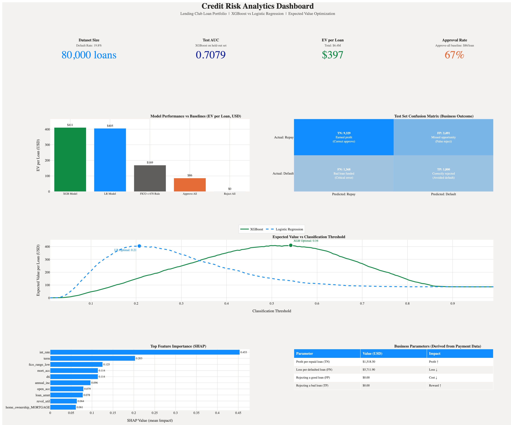

# Credit Risk Analytics: Lending Club

A credit scoring model that decides which loans to approve, tuned on expected profit per loan rather than accuracy, plus a SQL analysis of the same loan book. Individual project, April 2026.



## Problem

A lender loses much more on a loan that defaults than it earns on a loan that is repaid. A model with high accuracy can still lose money if it gets the expensive cases wrong. So the question here is not "how accurate is the model" but "which approval rule makes the most money per loan".

## Data

- Lending Club loans, 80,000 rows, 19.8% of them charged off (defaulted)
- Only finished loans are used: Fully Paid or Charged Off
- Profit and loss come from the data itself (`docs/data/business_parameters.csv`):
  - a repaid loan earns a median of **$1,519** in interest
  - a defaulted loan loses a median of **$5,712** after what the borrower paid back

The raw dataset is not in this repo. Put the CSV at `data/lending_club_80k.csv` (see How to run).

## Method

1. **Cleaning:** median imputation for missing values plus a flag column for missing employment length.
2. **Split:** 60% train, 20% validation, 20% test, stratified so each set keeps the same default rate.
3. **Preprocessing:** scaling for numeric columns, one-hot encoding for categories, ordinal encoding for term and employment length.
4. **Models:** Logistic Regression and XGBoost with class weighting for the imbalance.
5. **Expected value:** every decision is measured against not lending at all, which is worth 0.
   Approving a good loan earns the interest, approving a bad loan loses the net loss, and rejecting either one is 0.
6. **Threshold:** 200 cut-off points tried on the validation set; the one with the highest expected value per loan is kept.
7. **Baselines:** approve everything, reject everything and a simple rule that rejects FICO below 670.
8. **Checks:** 5-fold cross-validation, a stress test with higher default rates, and SHAP to explain the model.
9. **Test:** one final run on the untouched test set.

## Results

Expected profit per loan on the validation set:

| Strategy | EV per loan |
|---|---|
| XGBoost (threshold 0.54) | **$411** |
| Logistic Regression (threshold 0.21) | $405 |
| Reject if FICO below 670 | $169 |
| Approve everything | $86 |
| Reject everything | $0 |

On the held-out test set:

| Strategy | AUC | EV per loan | Loans approved |
|---|---|---|---|
| XGBoost | 0.708 | **$397** | 67% |
| Logistic Regression | 0.711 | $406 | 63% |
| Reject if FICO below 670 | | $155 | 82% |
| Approve everything | | $86 | 100% |

- Using the model to choose which loans to approve earns about **4.6 times** more per loan than approving everyone and **2.6 times** more than the FICO rule on the test set.
- XGBoost and Logistic Regression end up almost the same (5-fold CV: $394 vs $398 per loan, AUC 0.707 for both). The simpler model is just as good here, which also makes it easier to explain to a credit committee.
- The strongest drivers of default (mean |SHAP|) are **interest rate, loan term (60 vs 36 months) and FICO score**, followed by number of mortgage accounts and debt-to-income.
- Stress test: with the same threshold, the portfolio stays profitable until the default rate rises from 19.8% to roughly 28%, after which it starts losing money.

**Correction:** the first version of this project counted the principal saved by rejecting a bad loan as a gain, on top of the loss already counted for approving it. That double counting made "reject everything" look almost as profitable as the model ($2,409 vs $2,539 per loan). The numbers above use the corrected definition.

## SQL analysis

`sql/analysis.sql` answers eight questions about the loan book in SQLite, from simple `GROUP BY` queries to window functions and CTEs. Some of the findings:

- Default rate climbs from 5.9% in grade A to 47.4% in grade G, and 60-month loans default twice as often as 36-month loans (32.4% vs 15.8%).
- Debt consolidation accounts for $71.4M of the $114.5M lost on defaulted loans.
- Expected value of lending to each grade, using the same definition as the model:

| Grade | Loans | Default rate | EV per loan | Decision |
|---|---|---|---|---|
| A | 14,067 | 5.9% | $765 | lend |
| B | 23,265 | 13.3% | $707 | lend |
| C | 22,580 | 22.1% | $418 | lend |
| D | 12,075 | 30.3% | $122 | lend |
| E | 5,521 | 38.3% | -$233 | do not lend |
| F | 1,958 | 46.2% | -$846 | do not lend |
| G | 534 | 47.4% | -$1,000 | do not lend |

Grades E to G are 10% of the loans and lose money on average, even though they pay the highest interest rates.

## How to run

```sh
pip install -r requirements.txt

# model
jupyter notebook notebooks/credit_risk_pipeline.ipynb   # or: python src/credit_risk_pipeline.py data/lending_club_80k.csv
python src/create_dashboard.py                          # rebuilds docs/dashboard.* from docs/data/
python src/create_dashboard_v2.py                       # second layout, also uses data/lending_club.db (run sql/load_data.py first)

# SQL
python sql/load_data.py data/lending_club_80k.csv
sqlite3 -header -column data/lending_club.db < sql/analysis.sql
```

The last cell of the notebook saves its results to `docs/data/`, which the dashboard script and Power BI read. The numbers in this README come from the notebook. The script is a shorter version that drops rows with missing values instead of filling them, so its results are slightly different (test EV about $385 to $396 per loan, AUC 0.70 to 0.71).

## Repo contents

```
notebooks/credit_risk_pipeline.ipynb   full pipeline with outputs
src/credit_risk_pipeline.py            same pipeline as a script
src/create_dashboard.py                dashboard built from docs/data/
src/create_dashboard_v2.py             second dashboard layout (docs/dashboard_v2.*)
sql/load_data.py, sql/analysis.sql     SQL analysis
docs/                                  dashboard image, HTML and result CSVs
```

Tanakit Tuadpitak, Bachelor of Science in Digital Transformation and Innovation, Thammasat University
